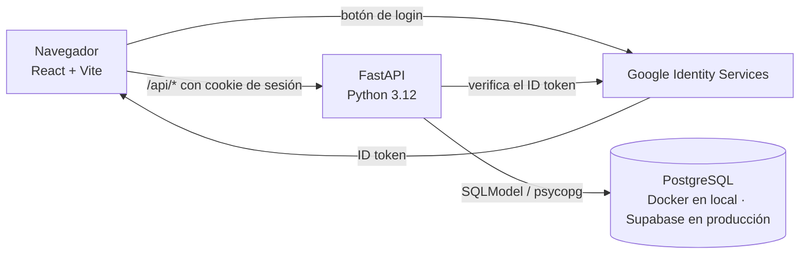
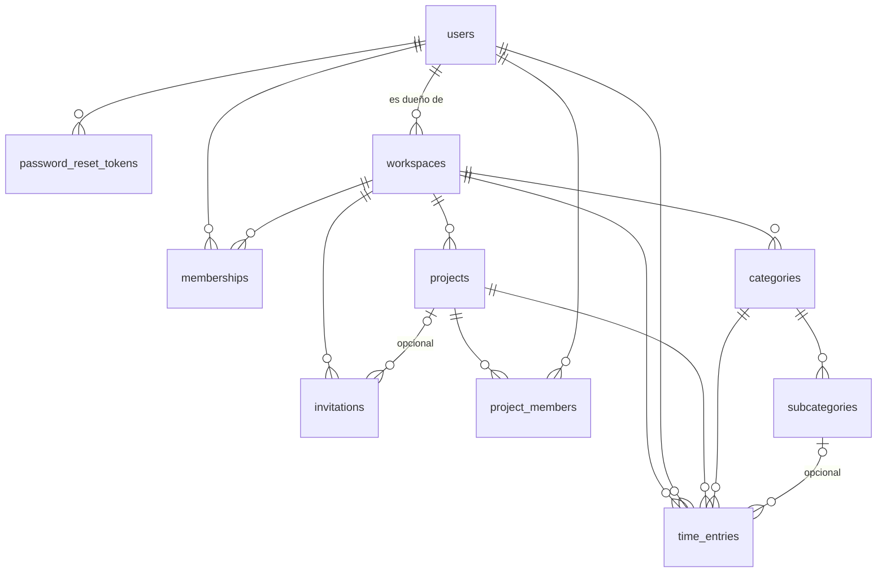

# Hourli-fy — Registro de horas

Web de registro de horas pensada para sustituir Clockify en estudios y equipos pequeños.
Cualquiera se registra con su email (Gmail, Hotmail, Outlook, el que use) y una contraseña, o
entra con Google; crea **espacios** aislados (un estudio, una
producción, un equipo) e invita a su gente con un link. Dentro de cada espacio, los miembros
apuntan en qué han trabajado (con cronómetro o a mano) en la **hoja de cada proyecto**, y el
dueño del espacio ve en su **panel** los totales quincenales de todo el equipo, con filtros y
gráficas.

Es un **registro**, no un sistema de nóminas: no hay aprobaciones, cierres de periodo ni
exportaciones.

- Especificación y plan por fases: doc "Registro de horas — Especificación y plan".
- [docs/CHANGELOG.md](docs/CHANGELOG.md): qué se ha hecho en cada fase y por qué (un
  `CHANGELOG-fase-N.md` por fase).
- [docs/development-workflow.md](docs/development-workflow.md): ramas, carpetas y forma de trabajar.
- [docs/REQUISITOS.md](docs/REQUISITOS.md): cuentas, claves y decisiones pendientes que tiene que
  hacer el autor (no se pueden automatizar).
- [specs/](specs/README.md): contrato de la API (`openapi.yaml`, generado) y flujos de usuario.

---

## Índice

1. [Cómo se usa](#cómo-se-usa)
2. [Vocabulario](#vocabulario)
3. [Quién puede hacer qué](#quién-puede-hacer-qué)
4. [Arquitectura](#arquitectura)
5. [Backend: módulo a módulo](#backend-módulo-a-módulo)
6. [Frontend: módulo a módulo](#frontend-módulo-a-módulo)
7. [Modelo de datos](#modelo-de-datos)
8. [Reglas de negocio](#reglas-de-negocio)
9. [Arrancar en local](#arrancar-en-local)
10. [Tests y comprobaciones](#tests-y-comprobaciones)
11. [Estado del proyecto](#estado-del-proyecto)

---

## Cómo se usa

1. **Entrar.** Con **email y contraseña** ("Crear cuenta" la primera vez, sin confirmar el email)
   o con el botón **"Iniciar sesión con Google"**. Si olvidas la contraseña, "¿Olvidaste tu
   contraseña?" te manda un link por email (caduca en 1 hora y sirve una vez).
2. **Crear un espacio** (máximo 5 propios sin archivar) o **unirte** a uno abriendo un link de
   invitación que te hayan pasado. Un link puede ser **al espacio entero** (ves todos sus
   proyectos, también los futuros) o **a un solo proyecto** (entras al espacio, pero solo ves ese
   proyecto).
3. **El dueño monta el catálogo** (pestaña *Catálogo*):
   - **Proyectos**, cada uno con su color (p. ej. "Película Pepe", "Anuncio Y").
   - **Labels** y **sublabels**: las partes del trabajo. Por ejemplo, "Acto 1" con
     "Entornos 3D", "Personajes" y "Arte 2D"; o "Gestión" y "Guion", sin sublabels.
4. **Registrar trabajo** (pestaña *Proyectos* → un proyecto). En la hoja del proyecto escribes
   qué has hecho ("Animaciones de personajes Pepe y Juan"), eliges label y, si quieres, sublabel,
   y:
   - pulsas **▶ Iniciar cronómetro** (y luego **Parar** en la cabecera), o
   - apuntas **a mano** el día y las horas de inicio y fin.

   Lo que registras ahí queda ligado a ese proyecto; no hay que elegirlo.
5. **Revisar tus horas** (pestaña *Mi hoja*): una hoja de cálculo de tu semana o tu quincena,
   con proyectos y labels en filas, días en columnas y totales.
6. **El dueño consulta el panel** (pestaña *Panel*): total de horas del equipo por quincena o
   rango de fechas, filtrable por persona, proyecto, label, sublabel y texto de la tarea; con la
   gráfica de horas por día, el reparto por persona, proyecto y label, y la lista de tareas.
7. **Mi cuenta**: tus datos, **cambiar o poner contraseña** y **eliminar la cuenta**. Más
   detalles en la página pública de **Privacidad**.
8. **Admin** (solo los emails de `ADMIN_EMAILS`): enlace "Admin" en la cabecera al panel `/admin`,
   para ver, buscar y corregir cualquier dato de la base de datos. Ver [Panel de admin](#panel-de-admin).

## Vocabulario

| En pantalla | En el código / BD / API | Qué es |
| --- | --- | --- |
| Espacio | `workspaces` | Contenedor aislado: un estudio, una producción, un equipo. Tiene un dueño y miembros. |
| Proyecto | `projects` | A lo que se imputan horas dentro de un espacio. Tiene su hoja de tareas. |
| Label | `categories` (tipología en la spec) | Parte del trabajo: "Acto 1", "Gestión". Común a todos los proyectos del espacio. |
| Sublabel | `subcategories` (subtipología) | Concreta una label: "Acto 1 › Personajes 3D". Opcional. |
| Tarea | `time_entries` (registro) | Nombre libre + label (+ sublabel) + inicio y fin, dentro de un proyecto. |
| Cronómetro | `time_entries` con `end_at` vacío | Tarea en marcha. Uno por persona, en todos sus espacios. |
| Quincena A / B | `period=2026-10-A` | A = días 1–15; B = del 16 al último día del mes. |

## Quién puede hacer qué

Los roles son **por espacio**: puedes ser dueño de uno y miembro de otro.

| Dentro de un espacio | Miembro | Dueño |
| --- | --- | --- |
| Ver proyectos y labels | Los suyos* | Todos |
| Registrar, editar y borrar **sus propias** tareas; cronómetro | Sí | Sí |
| Ver su hoja (semana / quincena) | Sí | Sí |
| Salir del espacio | Sí | No (antes transfiere o archiva) |
| Crear, renombrar y archivar proyectos, labels y sublabels | No | Sí |
| Crear y revocar links de invitación (al espacio o a un proyecto) | No | Sí |
| Decidir qué proyectos ve cada miembro ("Permisos") | No | Sí |
| Borrar un proyecto o el espacio (solo si no tienen horas) | No | Sí |
| Expulsar miembros, transferir la propiedad, renombrar o archivar el espacio | No | Sí |
| Ver el panel con las horas de todos | No | Sí |

\* Un miembro invitado al espacio ve todos los proyectos; uno invitado a un proyecto, solo ese
(y los que el dueño le añada). Las labels son del espacio y las ven todos sus miembros.

Nadie, ni el dueño, edita las tareas de otra persona. Si no eres miembro de un espacio, o no
tienes acceso a un proyecto, la API responde **404**, como si no existiera.

Aparte de los roles de cada espacio están los **administradores del servicio** (`ADMIN_EMAILS`):
no ven nada especial dentro de la app, pero en `/admin` tienen acceso a toda la base de datos.

### Panel de admin

`/admin` es un panel de [SQLAdmin](https://aminalaee.dev/sqladmin/) servido por la API (en local,
`http://localhost:5173/admin/` a través del proxy de Vite). Lista, busca, ordena y edita usuarios,
espacios, miembros, invitaciones, proyectos, labels, sublabels, tareas y links de recuperación.

- Entra quien tenga sesión en la app con un email de `ADMIN_EMAILS`, o quien haga login en el
  formulario del panel (en *Username* va el email) con su contraseña.
- **Edita la base de datos directamente**: se salta las reglas de la API (límite de 5 espacios,
  permisos…), aunque las restricciones de la propia BD siguen aplicándose (sin solapes, máx.
  24 h, nombres únicos).
- No se pueden borrar usuarios, espacios, proyectos ni labels (se archivan editando). Sí tareas,
  invitaciones y links de recuperación.
- Nunca muestra hashes de contraseñas ni de tokens.
- Cada cambio queda en el log de la API (`sqladmin.audit`) con quién lo hizo.
- La interfaz de SQLAdmin está en inglés (no trae español).

## Arquitectura



- **Frontend**: React 19 + TypeScript + Vite 8, Tailwind v4 + shadcn/ui, TanStack Query (caché y
  estados de las peticiones) y React Router. En local, Vite reenvía `/api` a FastAPI, así que el
  navegador ve un solo origen y la cookie funciona sin CORS.
- **Backend**: FastAPI + SQLModel (modelos = tablas + validación) + Alembic (migraciones), sobre
  PostgreSQL con el driver psycopg 3.
- **Login**: con email y contraseña (hash argon2) o con Google (un *ID token* firmado que la API
  verifica una vez). Entre por donde entre, la sesión es un **JWT propio** de 30 días en una
  cookie `httpOnly`, que JavaScript no puede leer.
- **Emails** (recuperar contraseña): en local se escriben en la consola de la API; en producción
  salen por [Resend](https://resend.com).
- **Despliegue** (fase 5): backend en Google Cloud Run (`backend/Dockerfile`, aplica las
  migraciones al arrancar), frontend en Cloudflare Pages (una Pages Function reenvía `/api` a Cloud
  Run, así la cookie es del mismo dominio), base de datos en Supabase y copia de seguridad diaria
  con GitHub Actions. Guía paso a paso en [docs/DESPLIEGUE.md](docs/DESPLIEGUE.md).

## Backend: módulo a módulo

`backend/app/`:

| Módulo | Qué hace |
| --- | --- |
| `main.py` | Crea la app, configura CORS y monta todos los routers bajo `/api`. |
| `core/config.py` | `Settings` (pydantic-settings): lee `DATABASE_URL`, `SECRET_KEY`, `GOOGLE_CLIENT_ID`, opciones de cookie y CORS desde `.env`. |
| `core/security.py` | Crea y valida el **JWT de sesión** (firmado con `SECRET_KEY`); genera los **tokens de invitación** y su hash SHA-256 (en la BD solo se guarda el hash). |
| `core/google.py` | Verifica el ID token de Google (firma, caducidad, que sea para nuestro Client ID). Va como dependencia para que los tests lo sustituyan por uno falso. |
| `core/passwords.py` | Hash y verificación de contraseñas con argon2 (`pwdlib`), con un hash ficticio para que "el email no existe" tarde lo mismo que "contraseña incorrecta". |
| `admin.py` | Panel `/admin` (SQLAdmin): una vista por tabla con lo que se ve y se puede tocar, y el acceso solo para `ADMIN_EMAILS` (con la cookie de la app o con el formulario del panel). |
| `db.py` | Motor de SQLAlchemy y `get_session()`: una sesión de BD por petición. |
| `schemas.py` | Lo que entra y sale en JSON (Pydantic): validaciones de nombres, colores `#RRGGBB`, fechas con zona horaria obligatoria, respuestas del panel… |
| `api/deps.py` | Dependencias compartidas: `CurrentUser` (de la cookie; rechaza cuentas eliminadas), `MemberAccess` (miembro activo del espacio de la URL, si no 404) y `OwnerAccess` (además dueño, si no 403). |
| `api/health.py` | `GET /health`: comprueba que la API responde. |
| `api/auth.py` | `POST /auth/register` y `POST /auth/login` (email y contraseña), `POST /auth/password/forgot` y `/password/reset` (recuperar), `POST /auth/password` (cambiar o poner), `POST /auth/google` (crea o une la cuenta), `POST /auth/logout`, `GET /auth/me` y `DELETE /auth/me` (eliminar la cuenta). |
| `api/workspaces.py` | Espacios: listar los míos, crear (máx. 5 propios), renombrar, archivar, **transferir la propiedad** y **borrar** (solo sin horas); miembros: listar (con su acceso), **permisos por proyecto**, salir, **expulsar**; invitaciones al espacio o a un proyecto: crear (el token solo se devuelve aquí), listar y **revocar**. |
| `api/invitations.py` | Rutas del link: `GET /invitations/{token}` (pública: a qué espacio o proyecto invita y si sigue valiendo) y `POST /invitations/{token}/accept` (unirse con el alcance del link; bloquea la fila para no pasarse de `max_uses`). |
| `api/catalog.py` | Proyectos (solo los accesibles para cada miembro), labels y sublabels: listar (con o sin archivados), crear, renombrar, cambiar color, archivar y **borrar proyectos sin horas**. Los nombres repetidos dan 409 a partir de la restricción única de la BD. |
| `api/entries.py` | Tareas: mis registros con filtros de días y proyecto, registro manual, editar y borrar los propios; cronómetro: `start` (para el anterior si lo hay), `stop` y `current`. |
| `api/reports.py` | Panel del dueño: `GET /reports/summary` (total, por persona, proyecto, label y día) y `GET /reports/entries` (lista paginada), con un `WHERE` dinámico y `GROUP BY` en SQL. |
| `services/access.py` | Acceso a proyectos: quién ve qué proyecto del espacio (`all_projects` o `project_members`), y dar o quitar accesos. |
| `services/workspaces.py` | Límite de 5 espacios propios (con `SELECT … FOR UPDATE` para que dos peticiones a la vez no lo salten) y estado de un link (`active`, `expired`, `revoked`, `exhausted`, `archived`). |
| `services/entries.py` | Reglas de las tareas: que proyecto, label y sublabel sean del espacio y no estén archivados; fin > inicio y ≤ 24 h; traducción de los errores de la BD (solapes, segundo cronómetro) a mensajes claros; parar el cronómetro (cortado a 24 h si se olvidó). Los días se calculan en hora de España. |
| `services/reports.py` | Filtros del panel: de `period=AAAA-MM-A/B` o `from`/`to` (por defecto, la quincena actual) a las condiciones SQL; búsqueda en el título sin distinguir mayúsculas y sin comodines. |
| `services/passwords.py` | Registro (409 si el email ya tiene cuenta), login con mensaje genérico, links de recuperación (1 h, un solo uso, solo su hash en la BD) y cambio de contraseña. |
| `services/email.py` | Envío de emails: `console` (local) o `resend`. Es una dependencia que los tests sustituyen para leer el link enviado. |
| `services/rate_limit.py` | Freno a la fuerza bruta en memoria: 10 intentos de login cada 15 min por IP + email, y 3 emails de recuperación por hora. |
| `services/account.py` | Eliminar la cuenta: exige no ser dueño de espacios activos, para el cronómetro, saca al usuario de sus espacios y **anonimiza** sus datos (sus horas siguen en los informes como "Usuario eliminado"). |
| `models/` | Tablas SQLModel: `user.py`, `password_reset.py` (links de recuperación), `workspace.py` (espacios y membresías), `invitation.py`, `catalog.py` (proyectos, labels, sublabels), `time_entry.py` (tareas, con sus restricciones) y `common.py` (`utc_now`, fechas `timestamptz`). |

Fuera de `app/`:

| Carpeta | Qué hay |
| --- | --- |
| `alembic/versions/` | Migraciones, en orden: usuarios, espacios, miembros e invitaciones (`c31077379cef`) → catálogo (`2c80dffbd7ee`) → tareas y `btree_gist` (`e442082a8fa8`) → cuentas eliminadas (`32d479a0015b`) → contraseñas y links de recuperación (`84efe5a21d70`) → acceso por proyecto (`e000194eb176`). |
| `tests/` | 167 tests con pytest sobre un Postgres real (BD `clockify_test`): `test_auth` (8), `test_password_auth` (21), `test_admin` (8), `test_project_access` (22), `test_workspaces` (17, incluido el aislamiento entre espacios), `test_invitations` (14), `test_catalog` (19), `test_entries` (33), `test_reports` (17), `test_account` (7) y `test_health` (1). `conftest.py` crea la BD de pruebas, envuelve cada test en una transacción que se deshace, sustituye el login de Google por uno falso y captura los emails en una lista (`outbox`). |
| `scripts/export_openapi.py` | Genera `specs/api/openapi.yaml` a partir de la app, para que el contrato nunca se desincronice. |

## Frontend: módulo a módulo

`frontend/src/`:

| Módulo | Qué hace |
| --- | --- |
| `main.tsx` | Monta la app dentro de `QueryClientProvider` (TanStack Query) y `BrowserRouter`. |
| `App.tsx` | Rutas. `/invite/:token`, `/privacidad` y `/recuperar` son públicas; el resto exige sesión (si no la hay, muestra el login). Cabecera con el cronómetro, "Admin" (si lo eres), tu nombre (enlace a *Mi cuenta*) y "Salir". |
| `pages/LoginPage.tsx` | Tarjeta de entrada con `AuthPanel` y el enlace a Privacidad. |
| `pages/PasswordRecoveryPages.tsx` | `/recuperar` (pedir el link por email) y `/recuperar/:token` (elegir contraseña nueva; al guardar ya entras). |
| `pages/WorkspacesPage.tsx` | `/`: mis espacios (activos y archivados) y formulario para crear uno, con el contador "N de 5 propios". |
| `pages/WorkspacePage.tsx` | Un espacio con sus pestañas: **Proyectos** (`/w/:wid`), **Mi hoja** (`/hoja`), **Panel** (`/panel`, solo dueño), **Catálogo** (`/catalogo`) y **Equipo** (`/equipo`: ajustes, miembros, invitaciones, transferir, expulsar, salir). |
| `pages/ProjectSheetPage.tsx` | `/w/:wid/p/:pid`: la hoja de un proyecto. Formulario de nueva tarea y mis tareas de los últimos 30 días agrupadas por día (con "Ver 30 días más"). |
| `pages/InvitePage.tsx` | `/invite/:token`: muestra a qué espacio invita el link; si no hay sesión, el `AuthPanel` sale ahí mismo (entrar o crear cuenta) y luego "Unirme". |
| `pages/AccountPage.tsx` | `/cuenta`: tus datos, "Contraseña" (cambiarla, o ponerla si entras con Google) y "Eliminar mi cuenta" (pide escribir «eliminar» y avisa de los espacios que hay que transferir o archivar antes). |
| `pages/PrivacyPage.tsx` | `/privacidad`: política de privacidad (**borrador** con datos por completar). |
| `components/auth/AuthPanel.tsx` | Pestañas "Entrar" / "Crear cuenta" con email y contraseña, "¿Olvidaste tu contraseña?" y, debajo, el botón de Google (solo si hay `VITE_GOOGLE_CLIENT_ID`). |
| `components/GoogleLoginButton.tsx` | Carga Google Identity Services, pinta el botón oficial y manda el ID token a la API. |
| `components/catalog/` | `ProjectsCard` (proyectos con paleta de colores validada para daltonismo), `CategoriesCard` (labels con sus sublabels) e `ItemActions` (renombrar en línea, archivar, crear, "ver archivados"). |
| `components/entries/` | `TimerBar` (cronómetro en la cabecera), `TaskForm` (nueva tarea con cronómetro o a mano), `EntryRow` (una tarea, con edición en línea que solo manda lo que cambia), `LabelPicker` (desplegables label → sublabel), `ProjectLinks` (pestaña Proyectos) y `TimesheetCard` (Mi hoja). |
| `components/reports/` | `ReportPanel` (filtros, total, reparto por persona/proyecto/label y lista paginada) y `DailyHoursChart` (gráfica de horas por día en SVG, con tooltip accesible por teclado y vista de tabla). |
| `components/NativeSelect.tsx` y `components/ui/` | Desplegable nativo con estilo de `Input`, y los componentes de shadcn (`button`, `card`, `input`, `badge`). |
| `lib/api.ts` | `apiGet` / `apiPost` / `apiPatch` / `apiDelete`: `fetch` a `/api` con la cookie; `ApiError` lleva el código y el mensaje de FastAPI para mostrarlo tal cual. |
| `lib/auth.ts` | `useMe()`: el usuario de la sesión o `null`. |
| `lib/time.ts` | Fechas **siempre en hora de España**, aunque el navegador esté en otra zona: días `AAAA-MM-DD`, semanas, quincenas, duraciones y "día + hora local → UTC" con el cambio de hora. |
| `lib/catalog.ts` | `useCatalog()`: proyectos y labels del espacio (archivados incluidos) con búsqueda por id y el texto "Label › Sublabel". |
| `lib/entries.ts` | `useCurrentTimer()`, `useNow()` (reloj que avanza cada segundo) y el refresco de datos tras cada cambio. |
| `lib/reports.ts`, `lib/types.ts` | Tipos de las respuestas de la API (espejo de `backend/app/schemas.py`). |

## Modelo de datos



| Tabla | Lo importante |
| --- | --- |
| `users` | `email` único y en minúsculas; `password_hash` (argon2) si tiene contraseña; `google_sub` (identificador de Google) si entra con Google; `deleted_at` si la cuenta se eliminó (datos anonimizados). |
| `password_reset_tokens` | `token_hash` único, `expires_at` (+1 hora), `used_at` (cada link sirve una vez). |
| `workspaces` | `owner_id`, `archived`. El límite de 5 propios sin archivar se comprueba en la API. |
| `memberships` | Clave `(workspace_id, user_id)`; `removed_at` en vez de borrar (al salir o ser expulsado); `all_projects` (ve todos los proyectos o solo los de `project_members`). |
| `project_members` | Clave `(project_id, user_id)`: a qué proyectos tiene acceso un miembro limitado; `removed_at` al quitárselo. |
| `invitations` | `token_hash` único, `expires_at` (+10 días), `max_uses` opcional, `uses`, `revoked_at`; `project_id` si invita a un solo proyecto. |
| `projects`, `categories` | Nombre único por espacio (archivados incluidos); los proyectos llevan `color`. |
| `subcategories` | Nombre único dentro de su label. |
| `time_entries` | `end_at` vacío = cronómetro en marcha. `CHECK` fin > inicio y ≤ 24 h; índice único parcial (un cronómetro por persona); **restricción de exclusión** con `btree_gist` que impide solapes de la misma persona. La duración no se guarda: es `end_at - start_at`. |

Todas las fechas se guardan en **UTC** (`timestamptz`) y se muestran en **Europe/Madrid**.

## Reglas de negocio

- **Aislamiento**: ningún dato cruza de un espacio a otro; cada ruta comprueba la pertenencia y
  hay tests que intentan leer y escribir en espacios ajenos.
- **Nada con horas se borra**: espacios, proyectos, labels y sublabels se **archivan**
  (desaparecen de los desplegables pero siguen en informes). Un espacio o un proyecto **sin
  ninguna tarea** sí se puede borrar de verdad. Las **tareas** también se pueden borrar, porque son
  datos de quien las registró y nada depende de ellas.
- **Acceso por proyecto**: un link a un proyecto da acceso solo a ese (no a los demás ni a los
  futuros); otro link suma proyectos; un link al espacio lo da todo. El dueño puede cambiar los
  permisos de cada miembro. Al quitar el acceso, sus horas siguen contando en el panel, pero ya no
  puede ver ni editar esas tareas.
- **Invitaciones**: links que caducan a los 10 días, revocables y con máximo de usos opcional. Si
  el link no te da nada nuevo, aceptar no gasta un uso. Archivar el espacio (o el proyecto del
  link) invalida sus links.
- **Propiedad**: el dueño no puede salir sin transferir antes el espacio; si no, lo archiva.
- **Tareas**: un cronómetro por persona (al arrancar otro, el anterior se para); sin solapes entre
  tus tareas, aunque sean de espacios distintos; máximo 24 h (un cronómetro olvidado se corta a
  las 24 h al pararlo).
- **Días y quincenas**: una tarea cuenta en el día (de España) en que **empieza**.
- **Panel**: solo cuentan las tareas terminadas; las horas de quien ya no es miembro siguen contando.
- **Eliminar la cuenta**: antes hay que transferir o archivar los espacios propios activos; los
  datos personales se anonimizan y las horas quedan como "Usuario eliminado".
- **Cuentas**: el registro no confirma el email. Por eso, si alguien entra con Google y ya hay una
  cuenta con contraseña con ese email, se unen **y se borra la contraseña** (podría haberla puesto
  otra persona que registró ese email antes). El login no dice si falló el email o la contraseña.

## Arrancar en local

Requisitos: [uv](https://docs.astral.sh/uv/), Node.js LTS y Docker Desktop. El **OAuth Client ID
de Google** es opcional: sin él solo se entra con email y contraseña (pasos para crearlo en
[docs/CHANGELOG-fase-1.md](docs/CHANGELOG-fase-1.md), "Configurar el login con Google").

Una vez:

```powershell
copy .env.example .env                       # credenciales del Postgres local
copy backend\.env.example backend\.env       # pon un SECRET_KEY propio, ADMIN_EMAILS y (opcional) GOOGLE_CLIENT_ID
copy frontend\.env.example frontend\.env     # (opcional) VITE_GOOGLE_CLIENT_ID, el mismo Client ID
cd frontend
npm install
```

Cada vez (PowerShell de Windows no admite `&&`: una línea por comando):

```powershell
docker compose up -d db                      # Postgres en 127.0.0.1:5432

# Terminal 1: API en http://localhost:8000 (documentación interactiva en /docs)
cd backend
uv run python -m alembic upgrade head        # solo si hay migraciones nuevas
uv run fastapi dev app/main.py               # si Windows lo bloquea: uv run python -m uvicorn app.main:app --reload

# Terminal 2: web en http://localhost:5173
cd frontend
npm run dev
```

Abre **http://localhost:5173** (con `localhost`, no `127.0.0.1`: es el origen autorizado en Google).
Los emails de recuperación aparecen en la terminal 1, con el link listo para copiar. El panel de
admin está en **http://localhost:5173/admin/**.

> **Smart App Control** de Windows bloquea a veces los `.exe` que instala uv (`alembic.exe`,
> `pytest.exe`, `uvicorn.exe`). Por eso se usan con `python -m …`, que es equivalente.

## Tests y comprobaciones

```powershell
cd backend
uv run python -m pytest                      # 167 tests (necesita el Postgres de Docker)
uv run ruff check .
uv run ruff format --check .
uv run python -m alembic check               # los modelos y las migraciones coinciden

cd ..\frontend
npm run lint
npm run build                                # incluye la comprobación de tipos
```

## Estado del proyecto

| Fase | Contenido | Estado |
| --- | --- | --- |
| 0. Base | Repo, FastAPI + SQLModel + Alembic, React + Vite, Postgres en Docker | Hecha |
| 1. Auth y espacios | Login con Google, espacios, miembros, invitaciones | Hecha |
| 2. Catálogo | Proyectos, labels y sublabels | Hecha |
| 3. Registro | Hoja de cada proyecto, cronómetro, registro manual, Mi hoja | Hecha |
| 4. Panel | Totales del equipo con filtros y lista de tareas | Hecha |
| 5. Deploy | Eliminar cuenta y página de privacidad: **hechas**. Docker, Cloud Run, Cloudflare Pages, Supabase y pantalla de consentimiento de Google: **pendiente, se hará en pareja** | En parte |
| 6. Extra | Gráficas del panel: **hechas**. Actividad en vivo con Supabase Realtime: **pendiente** (necesita Supabase, tras el despliegue) | En parte |
| 7. Cuentas y admin | Email + contraseña con cualquier dominio, recuperar contraseña por email, panel `/admin` | Hecha (va antes del despliegue) |
| 8. Acceso por proyecto | Invitar a un solo proyecto, permisos por miembro, borrar espacios y proyectos sin horas | Hecha (va antes del despliegue) |

El detalle de cada fase, con sus decisiones, está en `docs/CHANGELOG-fase-N.md`.
